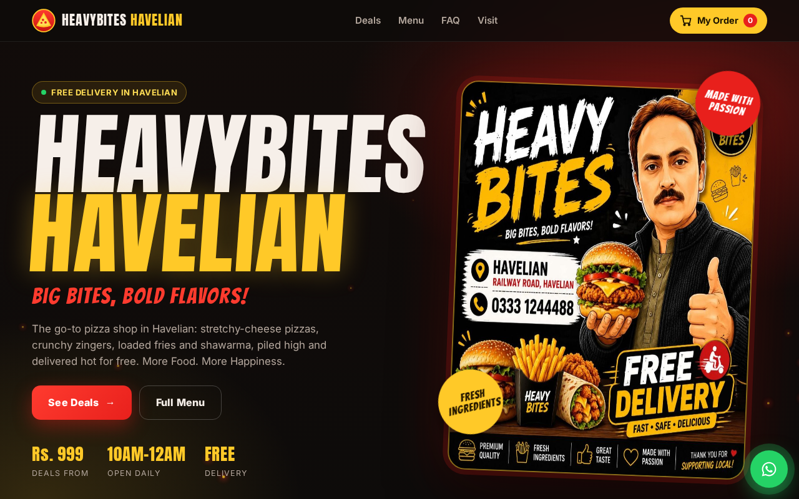

# Heavybites Havelian

**Live site: [heavybites-havelian.vercel.app](https://heavybites-havelian.vercel.app/)**

A mobile-first restaurant website for Heavybites Havelian (pizza, fast food & ice cream in Havelian, Pakistan). Every menu item and deal has a **WhatsApp order button**, so orders land straight on the shop's WhatsApp — no backend, no database, no commission.

## What it does

- Mobile-first menu with prices, deals and posters
- One-tap WhatsApp ordering per item, and full order checkout to +92 333 1244488
- Local SEO: JSON-LD `Restaurant` schema (geo, hours, menu) + `FAQPage` schema, robots.txt and sitemap.xml, targeting "pizza in Havelian" and nearby-city searches
- Content-driven: all menu items, prices and deals live in a single `menu-data.js` — the owner can edit the menu without touching any layout code

## Built with

- Pure HTML / CSS / JavaScript — no framework, no build step
- Deployed on Vercel with automatic deploys from this repo

## Repository guide (for the shop)

- **Edit prices / deals**: open `menu-data.js` — every item lives there; the site updates automatically.
- **Change the WhatsApp number**: edit `whatsapp` in `menu-data.js` (country code, no `+`), e.g. `923331244488`.
- **Deploy**: push to this repo; Vercel auto-deploys (no build command, no output directory).
- **Canonical URL** is set to https://heavybites-havelian.vercel.app/ — if moving to a custom domain, update it in `index.html`, `sitemap.xml` and `robots.txt`.

---

**Muhammad Umair** — freelance web developer, Abbottabad, Pakistan

- Portfolio: [portfolio-3d-nine-alpha.vercel.app](https://portfolio-3d-nine-alpha.vercel.app/)
- GitHub: [github.com/umairkhn1](https://github.com/umairkhn1)
- Email: nsumair006@gmail.com
